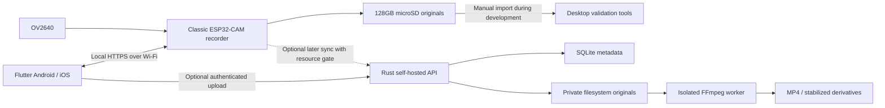

# System architecture

Status: baseline revised 2026-11-09 for classic ESP32-CAM, OV2640 and nominal
3.7V 1000mAh power. See [decision review](hardware-decision-review.md).
Wire/file contracts live in
[interfaces](specs/interfaces.md) and [media format](specs/media-format.md).

## 1. Delivery boundaries

Stage 1 is a standalone recorder. Bench validation tools may inspect SD files;
there is no dependency on a finished phone app or backend. Stage 2 adds local
ownership, control, preview, resumable download, raw playback, and signed OTA.
Stage 3 adds optional self-hosted storage, exports, stabilization and events.
Host-side stabilization feasibility starts early using Stage 1 samples.

The application does not become a mandatory proxy for recording. The backend
does not become the source of truth for device ownership or local availability.
Offline operation remains a first-class state throughout all stages.

## 2. Proposed source layout

| Future location | Responsibility |
| --- | --- |
| `firmware/` | PlatformIO/ESP-IDF C++ components, partitions, board definitions, host tests |
| `hardware/` | Revisioned schematic, BOM, pin table, layout, enclosure and assembly artifacts |
| `app/` | Flutter/Dart mobile app, platform integrations, parser/player and tests |
| `backend/` | Rust API/worker, migrations, storage, deployment examples |
| `contracts/` | JSON schemas, OpenAPI, valid/invalid fixtures and API examples |
| `tools/` | Media inspection, recording analysis, provisioning and bench utilities |
| `docs/` | Requirements, plans, measured evidence and operating documentation |

These directories are planned; only the documentation exists today. Do not add
empty application skeletons merely to make a diagram look implemented.

## 3. Device ownership and resource boundaries

Camera acquisition owns camera frame buffers until the SD writer consumes or
drops a frame. The writer alone mutates clip files. Network readers get immutable
finalized files; preview copies at most one reduced-rate JPEG with a bounded
lifetime. Control changes go through a serialized supervisor. SD operations,
downloads and pruning are scheduled through one storage coordinator.

Low priority work is shed in this order: preview, downloads/sync, optional IMU,
then explicit recording fault if the recording path itself cannot progress.
Never accumulate an unbounded frame queue. Never report a dropped frame as
recorded. Record actual timestamps, counts, gaps and faults.

## 4. Cross-component invariants

1. An original clip is immutable after finalization and has a stable ID and
   content hashes. Renaming directories is not sufficient evidence of durability.
2. Device monotonic time orders frames; UTC may be unknown. A phone time update
   cannot reorder or duplicate frames. Clock corrections start a new segment.
3. A download lease prevents pruning the relevant clip for at most 5 minutes.
   Lease renewal is bounded by storage pressure. A client must handle expiry.
4. Backend possession is confirmed only after manifest, media, index and hashes
   validate and a durable commit succeeds. Transport success alone is insufficient.
5. Event pinning, playback and OTA do not modify original bytes.
6. Acknowledgements describe completed persistence, not merely queued work.
7. All media processing takes bounded inputs; uploaded files, filenames and
   parameters are untrusted even on a home network.

## 5. Toolchain baseline and first dependency gate

Propose PlatformIO with ESP-IDF C++ for FreeRTOS, camera, SD, HTTPS and OTA control;
Flutter/Dart for both mobile OSes; Rust with Axum/Tokio/SQLite for self-hosting;
FFmpeg with the required vid.stab filters for host post-processing. Exact versions
and lockfiles are selected in package 0.2 after verifying a compatible combination.
Do not equate current upstream ESP-IDF with the version packaged by PlatformIO.

The existing firmware role explicitly expects an existing PlatformIO project.
Package 0.2 first creates a bounded bootstrap assignment and records board,
environment, pinned platform/framework, memory and build evidence. Adapt the role's
project facts before delegating application firmware; do not ask it to guess these
values. Native ESP-IDF or a third-party platform fork is a scope decision if the
official PlatformIO path cannot support the required module/features.

## 6. Deployment and operational model

The wearable power assembly is a removable protected 1S pack, reviewed connector/
switch/regulation and camera. Remove the whole camera from the harness, unplug
the pack and use a compatible separate charger. No onboard charger, load sharing
or recording-while-charging path is required. Programming/bench power remains a
separately reviewed configuration, not an owner charging input.

First fit is a small dog's chest harness and dry weather. Basic protective
housing/pack restraint precede wear; weather sealing is a future revision with
new validation. Small-first design does not automatically qualify larger-dog fit.

Local Wi-Fi is 2.4GHz, using a configured router/hotspot or a temporary device
SoftAP, enabled only within a physical local-access session. The radio starts
off; there is no remote wake/discovery while it is off. Proposed timers are
300s of authenticated inactivity and a 15min absolute session cap; checkpoint
transfers on expiry and physically reopen for resume. The separate 120s pairing
window governs new ownership, not an existing owner's token access. A hotspot
is useful only while nearby and enabled. The app must explain
local-network permission, internetless Wi-Fi and manual OS join steps. Local
TLS authenticates the device through a QR-pinned certificate; owner bearer tokens
authenticate the phone. The backend uses a separate credential and HTTPS endpoint.

The backend starts as one self-hosted instance with SQLite on local persistent
storage and a single worker. Horizontal scaling and public multi-tenant hosting
are outside v1. Keep original media private, document backup/restore of both DB
and blobs, and keep working files on a quota-limited scratch volume.
