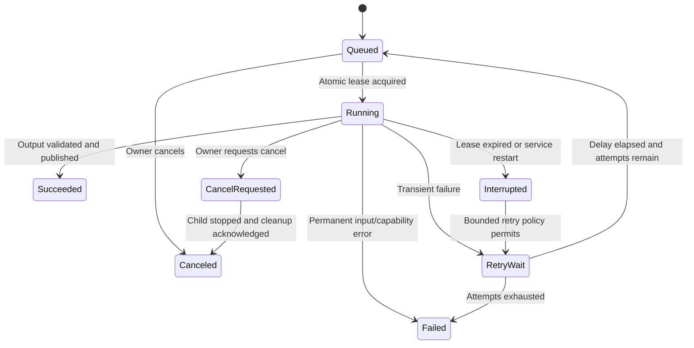

# Rust self-hosted backend specification

Status: proposed Stage 3 implementation baseline, updated 2026-11-09. No service exists
yet. The backend is optional: camera recording and local Flutter review must
already work without it. The proposed stack is Rust, Axum, Tokio, SQLite, a local
filesystem, and an isolated FFmpeg worker. Freeze exact versions, database
adapter, and container image digests during the toolchain milestone.

The canonical routes and JSON schema live in [interfaces.md](interfaces.md).
The source bundle and its validation rules live in
[media-format.md](media-format.md). This document specifies service behavior and
durability; do not invent competing endpoint payloads while implementing it.

The current device baseline is the classic AI-Thinker ESP32-CAM with OV2640,
nominal 3.7V/1000mAh battery, and an approximately 1–2-hour continuous-recording
runtime target. See [the hardware decision review](../hardware-decision-review.md).
These choices do not change this server's media/API contract or establish
measured runtime. Server operation must not depend on the camera having
ESP32-S3 resources or sustaining simultaneous recording and network transfers.
The default camera mode records with Wi-Fi off. A deliberate physical action
opens local access; no server polling, discovery, notification, or job can
remotely wake that radio. Local-access Wi-Fi expires after 300 seconds without
authenticated activity and at a 15-minute absolute cap even while active.
Physical reopening is distinct from the initial 120-second ownership-claim
window; existing backend/local-camera credentials are not reissued each session.

## 1. Requirements and scope

| ID | Requirement |
| --- | --- |
| BE-01 | An owner can deploy the service on their own Linux host with persistent storage and no mandatory external account. |
| BE-02 | Originals remain immutable; every playable/stabilized MP4 is a separately identified derivative. |
| BE-03 | Interrupted uploads resume without corrupting committed clips or charging the same bytes twice. |
| BE-04 | Restarted jobs are recoverable and cannot publish partial output as completed media. |
| BE-05 | Storage, parser input, worker resources, child-process duration, and notification retries are bounded. |
| BE-06 | Authorization applies to every metadata, media, upload, job, and event resource. |
| BE-07 | Optional notifications report known application events; internet absence or delivery failure is visible. |
| BE-08 | Data can be exported, deleted, backed up, and restored without a proprietary hosted service. |

The initial server is a single-owner installation with multiple registered
cameras/phones. Public registration, multi-tenant billing, object storage,
distributed workers, live remote camera proxying, automatic poison detection,
face recognition, geolocation, and mandatory push-service integration are out of
scope. SQLite and filesystem storage are deliberate first-version choices.

## 2. Architecture and proposed files

```text
backend/
  Cargo.toml
  Cargo.lock
  migrations/
  src/main.rs
  src/config.rs
  src/api/{auth,devices,uploads,clips,jobs,events,health}.rs
  src/domain/{identity,media,uploads,jobs,events}.rs
  src/storage/{database,files,reconcile}.rs
  src/workers/{runner,ffmpeg,notifications}.rs
  tests/{contracts,uploads,recovery,processing,authorization}/
  Dockerfile
  compose.yaml
```

HTTP handlers validate/authenticate requests and invoke domain services. Domain
services own state transitions and transactions. Filesystem operations use one
storage abstraction and generated paths. Worker code never accepts arbitrary
client FFmpeg arguments, executable paths, input URLs, or output paths.
Start with one HTTP process and one local worker slot. Avoid Redis, Kubernetes,
or a separate queue dependency until measured requirements justify them.

Use `tracing` or an equivalent structured logger; assign a request/job ID to
correlated events. Hashing, filesystem scans, and other blocking operations must
not monopolize Tokio executor threads. Bound blocking concurrency as well as
asynchronous request concurrency. The FFmpeg executable is an operator-configured
absolute path, checked at startup, not selected by uploaded metadata.

## 3. Configuration and startup

Proposed configuration keys below are a contract to implement, not existing
environment variables. Document defaults in `.env.example` when code is added.

| Key | Meaning |
| --- | --- |
| `VDOG_BIND` | HTTP listen address, loopback by default when deployed behind a TLS proxy. |
| `VDOG_DATA_DIR` | Absolute persistent directory holding database, originals, derivatives, staging, and work directories. |
| `VDOG_PUBLIC_URL` | Canonical external HTTPS URL for app configuration and links; no arbitrary Host-header reflection. |
| `VDOG_BOOTSTRAP_TOKEN_FILE` | Owner-only output/mounted credential file for the locally generated initial admin bearer. |
| `VDOG_STORAGE_QUOTA_BYTES` | Total managed-storage quota, set explicitly by operator before uploads are enabled. |
| `VDOG_FREE_SPACE_FLOOR_BYTES` | Physical free-space floor maintained before admitting new uploads/jobs. |
| `VDOG_WORKER_CONCURRENCY` | Default one; increase only after resource measurements. |
| `VDOG_FFMPEG_PATH` | Validated executable path in the deployment image. |
| `VDOG_JOB_TIMEOUT_SECONDS` | Finite per-attempt wall-clock deadline, recorded with processing recipe. |
| `VDOG_LOG_LEVEL` | Structured log level; never enables secret/media-body logging. |

Startup order: parse and validate configuration → create directories with
restricted permissions → acquire single-instance/storage lock → migrate schema
transactionally → reconcile interrupted file operations → recover stale worker
leases → validate FFmpeg capabilities → listen. An incompatible schema or unsafe
storage location fails readiness with an actionable operator error.

The first deployment target is a Linux host with SQLite and data on a local
filesystem. Network filesystems are unsupported until their durability and
locking semantics are tested. Container restart policy does not replace worker
recovery. Compose, Docker images, and launch commands are future deliverables;
the README must not describe them as already available.

## 4. Authentication and authorization

Generate a random 32-byte admin bearer credential through a local bootstrap CLI;
do not ship a default password or commit a token. Deliver it through an owner-only
file or a one-time local setup channel. An administrator issues/revokes separate
`owner` and `device-upload` API tokens through the contract's `/tokens` routes.
The phone stores an owner token and sends it directly as a bearer credential.
There is no v1 refresh-token/session-cookie exchange. Store token verifiers
rather than plaintext bearer credentials; responses return new bearer material
only at issuance. Support revocation and invalidate revoked credentials promptly.

Bind each issued credential to an installation owner and client/device role.
Every query includes owner scope even in the single-owner release, so adding a
second owner later cannot accidentally expose unscoped data. Camera registration
stores hardware identity and display metadata, not the phone's local-camera
bearer token. A registered backend camera ID does not grant firmware control.

Require HTTPS on the app-facing boundary. For a trusted private network, a local
TLS proxy or explicitly configured private CA is acceptable; disabling TLS
verification is not a setup path. CORS is closed by default because the initial
client is native mobile. Rate-limit authentication, upload initialization,
chunk writes, and job submission separately. Redact tokens, setup secrets,
notification credentials, footage, and location-bearing user notes from logs.

Direct camera uploads are deferred until a separate resource gate. If enabled
later, issue a scoped ingest credential that can upload for exactly one device;
it cannot browse other footage, administer users, or create arbitrary jobs.
The classic board may fail the recording-plus-upload resource gate. In that
case leave direct sync disabled, retain the phone-mediated path, and report the
unverified capability rather than reducing recording requirements or silently
pausing recording. A server retry policy must not flood a busy/offline camera.
Any later direct-device sync must checkpoint at the local session boundary and
resume only after physical reopening, without attempting to extend the absolute
cap. Missing contact between sessions is expected, not evidence that recording
stopped or that a danger event occurred. Saved station credentials do not imply
always-on network attachment. The qualified physical-control implementation
belongs to the hardware/firmware gate, not the backend.

## 5. Data model and invariants

Use schema migrations, foreign keys, uniqueness constraints, integer byte counts,
and UTC timestamps for server actions. Preserve the camera's clock confidence
and monotonic recording timeline independently. All server paths are generated
from validated internal IDs; no table stores a client-controlled absolute path.

| Entity | Minimum persistent state and constraints |
| --- | --- |
| `owners` / `clients` / `api_tokens` | Owner and client identity, verifier, role, issuance/revocation and optional configured expiry; never plaintext bearer. |
| `devices` | Owner, external device identity, hardware/firmware metadata, label, enrollment state; unique owner/device identity. |
| `uploads` | Owner/device/source clip ID, expected manifest/hash/file sizes, state, per-file committed offset, expiry, reserved bytes. |
| `clips` | Owner/device/source clip identity, manifest hash, card-local `capture_order`, finalized storage path, validation version, source timeline and byte counts. Unique source identity with explicit hash-conflict handling. |
| `derivatives` | Source clip ID/hash, recipe/version, output hash/size/type/dimensions/duration, generated path; immutable once published. |
| `jobs` | Type, deduplication key, state, attempt, lease/deadline, cancellation flag, progress phase, typed error and output identity. |
| `events` | Manual origin, requested interval, coverage/gaps, device/clip links, protection state and acknowledgements. |
| `notification_outbox` | Event/recipient/channel key, attempt, next-attempt time, delivered/dead state; deduplication constraint. |
| `deletions` | Tombstone and cleanup progress for idempotent media removal. |

An original becomes visible only when required files exist and validate. A job
cannot refer to a staging upload. A derivative cannot outlive its source linkage
without an explicit export policy. A completed upload repeated with identical
identity/hash returns the existing clip; a different hash for the same identity
returns a conflict and does not overwrite it.
Preserve `capture_order` as source metadata only: it is an increasing ordering
within the original card catalog, not a server-global sequence across cards or
devices. Server ingestion time is also not a substitute for recording time.

## 6. Resumable ingest and commit

The initial path is camera → verified phone download → backend. Upload files
individually using the allowlisted bundle names, never arbitrary archive paths.
The authoritative offset/chunk-size fields and routes are in the interface spec.

### 6.1 Initialize and reserve

Accept `{v,manifest_base64url}` containing unpadded base64url of the exact original
manifest bytes, with the interface contract's 32KiB request/16KiB decoded bounds.
Compute/store its hash, validate the decoded JSON and preserve bytes unchanged;
do not reserialize it. Deduplication compares this hash and both data-file hashes.

Validate the manifest schema, device ownership, per-file and aggregate sizes,
supported media version, requested IDs, and hash syntax before reserving quota.
Admit only when managed quota and physical free-space floor can cover the upload
and current reserved work. Store reservation and session atomically. A duplicate
initialization with the same idempotency key/manifest returns the same session.
Reserve capacity until commit, explicit abort, or bounded expiry cleanup.

### 6.2 Chunk write

Authenticate and acquire the single upload-writer lock. `PATCH
/uploads/{id}/files/{name}` accepts 1–1,048,576 bytes, `Upload-Offset`, and
`Upload-Checksum: sha256 <64 lowercase hex>`. Compare the requested offset to the
durable server offset, then stream a bounded chunk to its generated staging path. Reject
gaps, overlaps with changed bytes, oversized bodies, unknown file names, and
writes after commit. A wrong/repeated offset returns 409 with the authoritative
offset; after an ambiguous response the client uses `HEAD` on the same file route
before retrying. Never blindly append a retry. Acknowledge only bytes that have been flushed and represented
by the durable offset record. If a crash leaves bytes beyond that offset,
truncate them on recovery before accepting another write.

Limit chunk bytes while streaming, not just by `Content-Length`. Axum's default
extractor body limit does not automatically protect every manually streamed
body; apply an explicit stream limit on this path. See
[Axum body-limit documentation](https://docs.rs/axum/latest/axum/extract/struct.DefaultBodyLimit.html).
Coordinate reverse-proxy limits/timeouts with the negotiated chunk size.

### 6.3 Validate and publish

1. Lock the upload and transition to validating; reject new chunks.
2. Check actual file sizes and SHA-256 against the exact declared manifest.
3. Parse bounded JSON and index rows; validate sequential frame IDs, offsets,
   sizes, timestamps, JPEG boundaries/dimensions, CRCs, and cross-file counts as
   required by the media spec. Unknown or unsupported versions fail explicitly.
4. Move the validated bundle to its immutable final path on the same filesystem,
   flush files and parent-directory metadata using the supported host semantics.
5. Commit the clip record and mark upload complete in a database transaction.
6. Return the committed identity only after durable publication. Queue derivative
   processing only through an explicit job or documented opt-in policy.

Database transactions do not make a filesystem rename and a database update one
atomic action. Use a durable publication marker plus startup reconciliation:
validated staged files can finish publication; final files without a committed
row can be adopted only if their marker/hashes match; incomplete/unmarked output
is quarantined or removed. A committed row with missing bytes fails health checks
and media retrieval. Test every crash boundary. SQLite provides database-level
atomic transactions, not this application-specific cross-store protocol; see
[SQLite atomic-commit documentation](https://sqlite.org/atomiccommit.html).

## 7. Processing worker

### 7.1 State and scheduling



Use a deduplication key formed from owner, source content hash, job type, and
canonical recipe/version. Identical requests reuse queued/running/completed
results. An explicit reprocess operation changes recipe or creates a new
attempt according to the API contract, never silently overwrites a derivative.
Lease acquisition is transactional; a lease includes a finite expiry and
heartbeat. One local worker runs one job by default.

The diagram includes internal retry scheduling. Exposed wire states are exactly
`queued`, `running`, `cancel_requested`, `succeeded`, `failed`, `cancelled`, and
`interrupted` from the interface contract; `RetryWait` is not a new API enum.

Persist phase and progress when meaningful: validating → preparing timeline →
analyzing motion → rendering → validating output → publishing. Percentages are
best estimates and may be null; `100%` is reserved for durable success. After a
restart, expired running jobs are requeued with a recorded retry, incomplete
attempt directories are cleaned, and complete outputs are reconciled first.
Retry transient I/O/resource failures with bounded backoff, initially at most
three attempts. Invalid input, unsupported media, and missing filters do not
retry indefinitely.

### 7.2 Timestamp-preserving preparation

Do not invoke FFmpeg on concatenated MJPEG with an invented constant frame rate
and assume the result preserves the recording timeline. Read the validated frame
index and construct a private bounded input representation that carries the
actual frame timestamps. A first implementation may extract generated frame
names and an FFmpeg concat-duration list in the job directory. The implementation
must test first/last-frame duration semantics against the media contract.

Reject path traversal and prohibit external URL/protocol fetches. Generated frame
names contain no uploaded labels. Frame extraction and intermediate files count
toward scratch quota and are removed on terminal completion. For a long export,
process one bounded segment at a time before joining derivatives; do not load a
72-hour library into RAM or materialize every frame in a single job.

### 7.3 Derivative types

`transcode` creates an ordinary H.264 MP4 for mobile playback/export. Preserve
the source aspect ratio, avoid upscaling, use a supported mobile pixel format,
write seekable output suitable for download, and record codec/encoder/recipe.
No audio track is synthesized. Validate the frozen encoder/profile choice on
the supported Android/iOS devices before declaring broad playback support.

`stabilize` uses two passes on a timestamp-consistent intermediate: motion
analysis with `vidstabdetect`, then transformation with `vidstabtransform`.
FFmpeg documents these as paired analysis/transform stages and requires a build
with libvidstab. See the official
[filter source documentation](https://github.com/FFmpeg/FFmpeg/blob/master/doc/filters.texi).
Begin with one conservative server-owned recipe; accept only bounded named
presets, never client filter expressions. Record smoothing, zoom/crop behavior,
analysis settings, FFmpeg version/build identity, source hashes, and output hash.
The exact recipe is frozen after the early 20–30-clip experiment, not guessed
from a single stationary demonstration.

The output is a processed copy. Stabilization can crop useful ground detail,
misinterpret moving subjects, or amplify artifacts; it cannot restore obscured
objects or erase motion blur. Keep an original/processed comparison available.
Gyro-assisted processing remains a separate future capability requiring timestamp
synchronization, calibration, and an IMU recording contract.

### 7.4 Process isolation and limits

Spawn a configured FFmpeg executable through an argument-vector API without a
shell. Clear inherited environment except required allowlisted values; set a
private working directory, close stdin, restrict file access, and deny worker
network access at the container/OS boundary. Input files are read-only. Run as an
unprivileged user with memory/CPU/pid limits and bounded scratch storage.

Bound output/log bytes, resolution, frame count, decoded pixels, duration, and
wall time before and during execution. A timeout/cancellation must terminate the
child process tree, await it, close pipes, remove partial outputs, and release the
lease/reservation. Merely dropping an asynchronous future is insufficient.
Tokio exposes process cancellation controls, but the service must configure and
test them; see [Tokio Command](https://docs.rs/tokio/latest/tokio/process/struct.Command.html).

At startup and in CI, verify the actual FFmpeg binary's version, configuration,
required JPEG decoder/MP4 muxer/H.264 encoder, `vidstabdetect`, and
`vidstabtransform`. A missing optional stabilization feature is an explicit
capability error; readiness for basic ingestion may remain true. Record the
binary provenance and included licenses. FFmpeg's obligations vary with build
options and libraries, including GPL components; do not claim the whole project
or a distributed FFmpeg binary has only the repository's existing MIT terms
(copyright 2026 Zensor lab). Keep the existing repository license and review
third-party binary/source-distribution obligations separately. See
[FFmpeg's licensing guidance](https://ffmpeg.org/legal.html).

## 8. Events, protection, and notifications

An initial event is an owner's manual mark attached to 1–10 existing finalized
clip IDs. An intended time interval is resolved to clip-level coverage by the
client; the endpoint accepts the contract's explicit clip list. Store requested
coverage and actual coverage separately. If a source clip
was already overwritten, return the missing interval; do not fabricate it from
timestamps. Backend protection means exemption from backend automated retention.
It does not imply the source SD copy is protected. Device protection requires a
separate device acknowledgement and is shown independently in the app.

Backend storage uses a bounded protected budget. If protection cannot be granted,
return the capacity reason and leave the previous state unchanged. Do not resolve
full protected storage by silently deleting protected originals. Show the effect
on ordinary retention and require an owner retention decision where needed.

Create notifications through a transactional outbox so a committed event and its
notification intent cannot diverge. Start with in-app status and an optional
operator-configured webhook; mobile APNs/FCM integration is a later deployment
option, not a dependency for recording. Never contact a webhook supplied in an
uploaded clip; destinations are administrator configuration and must be reviewed
for network access policy. Sign delivery requests if the chosen integration
supports it. Retries have bounded attempts/backoff and idempotency keys.
Display queued/delivered/failed as application states; provider acceptance is
not proof that a person read an alert. Wi-Fi-only cameras cannot promise remote
alerts while offline or away from a usable network.

## 9. Storage lifecycle, operations, and privacy

Original and derivative retention are independent policies. Initially disable
automatic deletion of originals until the owner configures it. Derivatives can
be regenerated, but still require an explicit documented cleanup policy.
Admit new work only after accounting for committed bytes, reserved uploads,
derivatives, scratch, and physical free space. Do not use a logical database
quota as a substitute for filesystem checks.

Deletion is owner-scoped and idempotent: mark deleting transactionally, stop new
jobs, cancel or wait for active work, unlink allowlisted managed files, remove
dependent records, then finish the tombstone. Never follow symlinks out of the
data root. Existing media downloads must either finish through an open safe file
handle or fail cleanly; they must not read a newly reused path.

Health has two levels: liveness confirms the process responds; readiness checks
database access/migrations, data-volume writability/free-space floor, and needed
runtime capabilities. Expose detailed diagnostics only to authorized operators.
Metrics include upload failures, hash mismatches, reserved/used bytes, queue age,
job failures/timeouts, processing time, and notification backlog. Do not label
raw footage as metrics or send it to third-party observability services by default.

Provide backup/restore commands covering the database, immutable media, and
configuration needed to resolve it. Use SQLite's supported backup strategy or a
documented stopped-service backup; copying only the main DB file during writes
is not a complete procedure. Keep service credentials out of portable footage
exports. A restore drill must recreate clip retrieval, job/source linkage, and
owner access on an empty host. Document what happens to expired credentials and
pending uploads after restore.

## 10. Acceptance evidence and future commands

| Test | Observable pass condition |
| --- | --- |
| BE-T01 offline ownership | A self-hosted deployment needs no external account; a phone configures an owner API token without cloud registration. |
| BE-T02 authorization | Another client/owner scope cannot enumerate or read any clip, upload, derivative, event, or job. |
| BE-T03 resume | Disconnect and kill the server before/after chunk writes and acknowledgements; resume produces the exact source hashes. |
| BE-T04 idempotence/conflict | Duplicate init/commit/job requests reuse one result; changed content under an existing source identity is rejected. |
| BE-T05 hostile media | Oversized JSON/frames, bad offsets/CRCs/hashes, traversal names, unsupported versions, malformed JPEGs, and body-limit bypass attempts cannot publish media. |
| BE-T06 publication recovery | Crashes at each file/DB transition leave no visible incomplete clip and no unreconciled quota leakage. |
| BE-T07 worker safety | Timeout/cancel/restart kills and reaps subprocesses, releases reservations, and never publishes a partial derivative. |
| BE-T08 timeline | Variable-FPS and dropped-frame fixtures preserve relative timing within the tolerance fixed by the media contract. |
| BE-T09 MP4 compatibility | Output plays/seeks on the selected physical Android/iOS devices, with correct dimensions and duration. |
| BE-T10 stabilization | The representative 20–30-clip comparison records ground-detail usefulness, crop, artifacts, processing resources, and failures; acceptance is based on the agreed quality rubric. |
| BE-T11 capacity | Full disk/quota, protected budget exhaustion, and expired uploads produce recoverable errors without deleting protected originals. |
| BE-T12 operations | Clean-host backup restore and schema migration preserve media identity and owner isolation. |
| BE-T13 notifications | Retries deduplicate events, bounded failures enter dead state, and offline delivery is shown accurately. |
| BE-T14 optional device sync | A failed classic-board recording/upload resource gate leaves direct sync disabled and recording requirements unchanged. If admitted later, idle/absolute Wi-Fi expiry checkpoints upload and waits for physical reopening without remote wake; phone-mediated upload retains the same validated bundle contract. |

Future checks from `backend/` are `cargo fmt --check`, `cargo clippy --all-targets
-- -D warnings`, `cargo test`, and `cargo build --release`; no Cargo project exists
today. Processing tests must run against the exact FFmpeg build used in deployment.
Record crate lockfile revision, FFmpeg provenance, host limits, fixture revision,
test result, and crash-injection boundaries. Unit tests without the actual worker
do not verify media processing or mobile compatibility.
