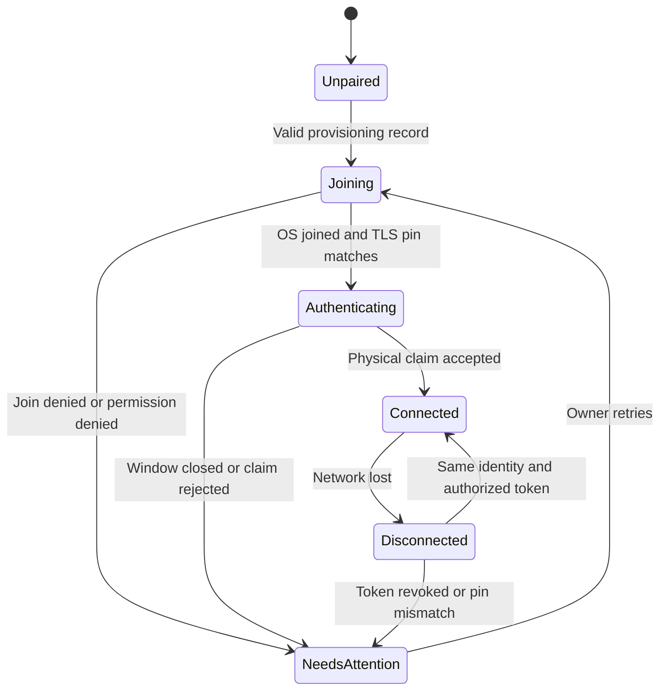

# Flutter companion application specification

Status: proposed implementation baseline, updated 2026-11-09. No application exists yet.
The source conversation proposed Flutter for Stage 2; detailed behavior below is
an engineering baseline for that choice. The canonical wire contract is
[interfaces.md](interfaces.md), and the recording bundle is defined in
[media-format.md](media-format.md). If those contracts change, update fixtures,
the firmware, this application, and the backend together.

The current hardware decision is the classic AI-Thinker ESP32-CAM with OV2640
and a nominal 3.7V, 1000mAh battery; approximately 1–2 hours of continuous
recording is the runtime target, not a measured result. See
[the hardware decision review](../hardware-decision-review.md) for the decision,
qualification gates, and remaining board/power uncertainties. This app must
not infer ESP32-S3 memory or concurrency capabilities from earlier proposals.
Normal use is recording with the radio off. Local Wi-Fi access is an on-demand
session opened through a deliberate physical action on the camera, not an
always-connected prerequisite for recording.

## 1. Purpose and boundaries

The application lets an owner connect to a nearby camera, confirm that it is
recording, find and download footage, and review it without an account or an
internet connection. An optional self-hosted backend adds durable copies,
standard MP4 exports, and post-processing stabilization in Stage 3.

| ID | Requirement |
| --- | --- |
| APP-01 | Local pairing, status, preview, download, and original playback work without a backend. |
| APP-02 | Closing the application, losing Wi-Fi, or losing internet never instructs the camera to stop recording. |
| APP-03 | A verified download means every required file matches its manifest size and SHA-256; a progress bar reaching 100% alone is insufficient. |
| APP-04 | Original footage and a processed derivative are visibly distinct; processing never replaces the original. |
| APP-05 | Camera ownership, phone authorization, and backend API-token configuration are separate concepts. |
| APP-06 | An unavailable camera, denied permission, exhausted SD space, and absent internet have separate recovery messages. |
| APP-07 | No mandatory subscription, telemetry, location collection, microphone permission, or backend registration. |
| APP-08 | All local media is private to the application until the owner explicitly exports or shares it. |
| APP-09 | Camera resource pressure pauses or rejects network work before it compromises recording; the app reports the resulting feature/transfer state truthfully. |
| APP-10 | The app explains physical Wi-Fi activation, session expiry, and reconnect without claiming remote wake or forcing ownership re-pairing. |

The first mobile targets are Android and iOS. Desktop/web clients, continuous
remote streaming, BLE provisioning, on-phone stabilization, automatic incident
classification, and background transfer guarantees are outside the initial scope.
Exact Flutter/Dart, Android SDK, iOS deployment target, and dependency versions
must be frozen at the toolchain milestone and recorded in lockfiles. Do not
infer supported OS versions from this document's examples.

## 2. Architecture and proposed files

Use feature directories with presentation, application, and data boundaries.
Widgets call controllers; controllers call repositories; repositories use clients
and persistent storage. Shared contracts are the only place for wire DTOs.
Do not perform network operations in widget build methods.

```text
app/
  lib/main.dart
  lib/core/{config,errors,logging,storage,network,lifecycle}/
  lib/contracts/                     # generated or fixture-tested DTOs
  lib/features/pairing/
  lib/features/devices/
  lib/features/preview/
  lib/features/library/
  lib/features/downloads/
  lib/features/player/
  lib/features/settings/
  lib/features/firmware_update/
  lib/features/backend/
  lib/features/events/
  test/{contracts,unit,widgets}/
  integration_test/
```

Choose one state-management package and one local database adapter during the
toolchain milestone; record the choice rather than mixing patterns. SQLite is
the proposed local metadata store. Store large files in application-private
directories, not database blobs. Keychain/Keystore-backed storage holds device
tokens and backend tokens; the database holds references to those secrets.
Do not keep setup QR images or secret-bearing debug logs.

Recommended application interfaces:

| Interface | Responsibility |
| --- | --- |
| `CameraConnection` | Resolve current address, validate certificate pin, own request timeouts and cancellation. |
| `DeviceRepository` | Pair, load status/capabilities, revoke a phone token, update supported settings. |
| `ClipRepository` | Page immutable camera/server clip metadata and merge local availability. |
| `DownloadManager` | Persist byte-range progress, verify files, and atomically publish local bundles. |
| `IndexedJpegReader` | Parse bounded frame indexes and return exactly one indexed JPEG payload. |
| `PlaybackController` | Map elapsed playback time to frame timestamps and release decoded images. |
| `BackendRepository` | Configure/revoke a server token, register device metadata, resume uploads, submit and poll jobs. |
| `PermissionService` | Present rationale, call platform permission APIs, and map denial to recovery actions. |

## 3. Persistent data and identity

Persist schema-versioned records and transactional migrations from the first
application release. A failed migration leaves media files intact and reports a
recoverable error; it must not silently reset the library.

| Record | Minimum contents |
| --- | --- |
| Paired camera | `device_id`, display name, certificate fingerprint, secret-store token key, last address, last seen time, firmware/hardware identity. |
| Clip | Composite source device/clip identity, immutable manifest hash, card-local `capture_order`, recording time with explicit clock confidence, duration, dimensions, file sizes/hashes, camera/local/backend availability. |
| Transfer | Source identity and fingerprint, local temporary path, manifest hash, file name, verified received offset, retry state and last typed error. |
| Backend connection | User-entered base URL, display name, trusted certificate configuration, secret-store token key, connection state. |
| Processing job | Server job ID, source clip identity, requested recipe/version, server state, last poll and derivative metadata. |
| Event | Server/device event ID, referenced clip IDs, requested coverage, origin `manual`, protection acknowledgement, synchronization state. |

Treat IDs as opaque contract-defined strings, never file paths. Keep filesystem
paths internal and generated. A matching clip ID with a different manifest hash
is a conflict requiring quarantine; it is not an updated version of the file.
Store null wall-clock times as null. Do not substitute the phone's download time
for the camera's recording time. Unknown-time recordings are grouped by device,
boot/session, and recording order as defined in the media contract.
`capture_order` orders captures only within the originating card's catalog; do
not use it to assert a global order across cards or devices.

## 4. Pairing and local connection

### 4.1 Initial ownership claim

1. Show a short explanation of local access and camera recording independence.
2. Scan the camera's provisioning QR, or offer equivalent manual entry. Request
   phone camera permission only for QR scanning; denial leaves manual entry usable.
3. Parse an allowlisted QR schema with length limits. Display the camera identity
   before joining. Reject malformed URLs, unsupported schema versions, and fields
   that attempt to invoke arbitrary platform intents.
4. Ask the owner to activate the camera's physical local-access session and open
   its 120-second ownership-claim window. The claim timer governs `/pair` only;
   it is not the duration of an authorized preview/download session.
5. Request the OS-supported Wi-Fi join flow, or show manual Wi-Fi settings steps.
   Explain that the camera access point may have no internet access.
6. Connect over HTTPS and validate the exact SHA-256 fingerprint of the DER
   certificate from the provisioning record. A mismatch stops all authenticated
   traffic and opens a re-pairing explanation; never offer a trust-all switch.
7. Call the pairing endpoint with the setup secret only during the physical
   window. Store the returned per-phone token in secure storage and discard the
   transient setup-secret buffer. Do not put secrets in query parameters.
   An `ALREADY_OWNED` response directs the owner to the documented physical
   ownership-recovery procedure; opening a pairing window must not silently
   replace an existing owner's authorization.
8. Load capabilities and status, then open the device screen. Pairing success
   does not mean recording is healthy: show the actual recorder/storage status.



### 4.2 Discovery and network changes

For a previously owned camera, first show instructions to open local Wi-Fi
access physically. Once the radio is on, reconnect using the stored device ID,
certificate pin, and authorized token; do not call `/pair` again or require a new
ownership claim merely because the previous Wi-Fi session ended. The actual
physical control/pin must be qualified for the purchased board. App instructions
must match that reviewed control and must not assume a generic GPIO0/button
assignment is safe on a board where a pin can serve the camera clock or boot mode.

The default recording-only mode has no Wi-Fi discovery or remote wake. An app
cannot reach the camera to enable a radio that is off. Present this as the
expected access workflow, not as a request to fix internet or reclaim ownership.
While disconnected, show last-known recording/storage values as stale; do not
assert that recording is currently healthy merely because it was healthy before.

A local-access session turns Wi-Fi off after 300 seconds without authenticated
activity. Authenticated work renews that idle timer, but each session has an
absolute 15-minute cap; the owner must physically reopen access afterward.
Show impending expiry when session metadata is available, checkpoint transfers,
close preview, and offer physical-reopen/reconnect steps. After reopening, reuse
the same owner token and resume against the same manifest, reacquiring a clip
lease if needed. If the qualified physical-button policy supports explicit
session closure, document that action. No session expiry stops recording.

Use the documented access-point address (baseline `192.168.4.1:443`) after joining
the QR-identified network for initial setup. Optional mDNS can
improve discovery on a shared LAN; it is not the only way to connect. Discovery
results are untrusted until the device identity and certificate pin match.
Manual address entry must retain pin validation. Limit discovery to the owner's
requested local discovery action; do not sweep arbitrary address ranges.

Changing camera Wi-Fi settings may disconnect the current session. Validate
configuration locally, send it once, show a reconnect state, and rediscover the
same camera. The app must not repeatedly overwrite settings while retrying.
Do not promise that the phone can simultaneously use camera Wi-Fi and a backend;
network routing and hotspot behavior vary by OS and handset. Download first,
then reconnect to an internet-capable network for backend upload when necessary.
Saved station credentials, if that capability is qualified, do not mean the
camera stays joined between physical local-access sessions.

### 4.3 Platform permissions

Requirements must be checked against the frozen minimum/target SDK before
implementation and every target-SDK upgrade. The initial strategy favors
explicit joins and manual address fallback over broad network scanning.

| Platform/action | Required implementation behavior |
| --- | --- |
| iOS local device access | Add a meaningful `NSLocalNetworkUsageDescription`; handle denied/revoked access with Settings guidance. Add `NSBonjourServices` only for service types actually browsed. Raw multicast may require an additional entitlement. |
| iOS Wi-Fi join | Investigate `NEHotspotConfigurationManager` and required capability for the frozen deployment target; always provide manual join. Do not assume the app can toggle Personal Hotspot. |
| Android Wi-Fi management | Request `NEARBY_WIFI_DEVICES` when required by the selected API/SDK. Older OS/API paths may need location permission; avoid scan APIs when unnecessary and do not collect physical location. |
| Android target API 37+ | Adopt `ACCESS_LOCAL_NETWORK` runtime permission, or an applicable system-mediated device picker. Handle denial before attempting local traffic. |
| Android target API 36 or lower | Do not add/request the API 37-only local-network permission. Recheck this rule when selecting the target SDK. |
| QR camera access | Ask only when scanning; allow manual provisioning. |
| Media export | Use system share/save APIs and their scoped access. Do not request broad storage access solely to store private downloads. |
| Notifications, Stage 3 | Ask at the feature's first use; denial does not disable the media library. |

Apple documents local-network privacy keys and Bonjour requirements in
[TN3179](https://developer.apple.com/documentation/technotes/tn3179-understanding-local-network-privacy).
Android documents [nearby Wi-Fi permissions](https://developer.android.com/develop/connectivity/wifi/wifi-permissions)
and the target-dependent [local-network permission](https://developer.android.com/privacy-and-security/local-network-permission).
The [Android Network Request API](https://developer.android.com/develop/connectivity/wifi/wifi-bootstrap)
uses a system approval flow for peer-device access and does not itself provide
internet. These platform facts were checked on 2026-11-07.

## 5. Screens and observable states

| Screen | Required content and actions | Empty/error behavior |
| --- | --- | --- |
| Home/device list | Paired cameras, last-seen age, current connection, physical local-access instructions, add camera. | No camera: pairing entry; disconnected/radio-off workflow: last-known values labeled stale, no remote-wake button. |
| Camera dashboard | Actual recording state, SD health/free bytes, estimated retained window, power indication if measured, firmware and Wi-Fi state. | Unknown battery is shown as unavailable, never an invented percentage. Storage faults remain visible even when preview works. |
| Preview | Live image, age of last frame, lower-priority notice, stop preview, local-session expiry if known. | Stale image gets an overlay; resource pressure or session end stops preview and gives the appropriate retry/physical-reopen action. |
| Camera library | Cursor-paged clips, time confidence, duration, size, download action. | No clips, recovering index, expired cursor, and offline are distinct. |
| Local library | Verified originals, local derivatives, upload/export actions. | Partial downloads appear only in transfer list, not as playable complete clips. |
| Player | Play/pause, seek, elapsed/duration, original/processed label, export if available. | Corrupt frame: mark gap and continue when safe; invalid index: stop with integrity error. |
| Transfers | Per-file verified bytes, queued/running/paused/failed/completed, retry/cancel, local-session boundary guidance. | Session expiry checkpoints; physical reopen/reconnect resumes only against the same immutable source. |
| Settings | Supported recording profile, network setup, current-phone authorization/revocation, optional backend, privacy controls. | Unsupported capability is omitted or explained; never silently ignored. |
| Firmware update | Current/new version, board compatibility, signature/source information, recording interruption and recovery instructions. | Unsupported, invalid signature, unsafe power, upload failure, rollback, and success are separate states. |
| Backend/jobs, Stage 3 | User-configured server/token, uploads, processing state, derivatives, manual events. | Local features remain usable while server is offline or unauthenticated. |

Status polling is foreground-only, initially every five seconds with exponential
backoff to thirty seconds after failures; navigating away cancels polling. These
are application defaults, not API guarantees. Accessibility requirements include
screen-reader labels, scalable text, large tap targets, and status expressed in
words as well as color. Start with English and Simplified Chinese localization
files; any untranslated text falls back to English without breaking layout.
Polling occurs only during an established local-access session. Stop when the
session ends; repeated requests must not be presented as a way to wake the radio
or bypass the 15-minute absolute cap.

The nominal 1000mAh battery capacity is hardware configuration, not a live charge
reading. Do not derive battery percentage, remaining minutes, or a guaranteed
1–2-hour runtime from capacity alone. Display measured values only when the
qualified hardware exposes them and the relevant calibration exists; otherwise
show battery/runtime as unavailable. Retained recording duration remains
separate from continuous battery runtime.

Show the owner charging procedure in device help: remove the camera from the
harness, use any approved shutdown action, unplug the pack and charge it in the
compatible external charger. The camera is offline while its pack is removed;
this is not evidence of SD failure or lost ownership. Do not show an onboard
charging state inferred from an external-power flag. On reconnect load actual
recording/recovery state. State dry-weather-only and use the reviewed small-dog
chest-mount guide, without promising universal size or weather protection.

## 6. Preview, download, and storage

The classic ESP32-CAM baseline is recording first. Simultaneous recording,
preview, and download are not assumed to fit its memory, SD, CPU, TLS, or power
budget. Initially permit only the network operations demonstrated by the
hardware-specific capability/resource gate. A rejected operation is shown as
unavailable or waiting for recorder resources; an in-progress transfer can pause
and checkpoint. Do not stop recording to make preview or download succeed.
These gates do not lower the existing recording profile, useful-quality, or
retention acceptance targets. An unproved required feature remains a blocked
milestone criterion, not a passed feature hidden from the UI.

Preview is an authenticated best-effort MJPEG stream, distinct from the SD
recording stream. Honor capabilities and server throttling; use at most one
preview connection and cap the initial client request at two frames per second.
Do not open extra camera captures to render a preview. Bound multipart headers
and payload length, discard superseded frames, and release the previous image.
Entering background or leaving the screen closes the stream.

Download only finalized immutable bundles. The manager must:

1. Fetch and validate the manifest before reserving local space.
2. Reserve required bytes plus temporary-file overhead within a user-visible
   local storage budget; reject new work before exhausting the phone volume.
3. Acquire a clip lease before downloading. Send `X-Clip-Lease` on file requests,
   renew through the lease endpoint before the five-minute TTL expires, and
   release it on completion/cancel. Renewal may be denied under storage pressure;
   checkpoint promptly rather than assuming an indefinitely pinned source.
4. Download allowlisted bundle files to `.partial` paths, using byte ranges and
   immutable validators as defined in the interface contract.
5. Persist progress only after corresponding bytes reach the local file. On
   restart reconcile persisted offset against actual length and truncate any
   unacknowledged tail before resuming.
6. Revalidate identity and manifest on reconnect. A reclaimed source returns
   `410 CLIP_GONE`; show that its camera copy expired and preserve the partial file
   until retry/cancel policy resolves it. Do not present an expired lease as
   proof that all partial bytes are corrupt.
7. Verify size and SHA-256 of every file, parse the index under media limits,
   then atomically rename the complete bundle and commit its library record.
8. Make repeated download requests converge on the same verified local bundle.

Default to one camera download and one TLS connection total. Request bounded
ranges initially ≤1MiB with target duration ≤30s, then reuse/release the connection
for lease renewal/status before the next range. Pause status polling and preview
while a stream owns the slot; another action must not require a concurrent TLS
connection. Recording has priority: a camera busy
response pauses the transfer rather than triggering aggressive parallel retries.
The 300-second transfer-lease TTL and Wi-Fi idle timer are independent controls.
The 15-minute Wi-Fi cap can interrupt a transfer even with a valid lease; keep
verified partial bytes and resume after physical reopening. Do not claim that a
lease extends the radio session or that session renewal extends a lease.
Cancellation closes network/file handles and retains or removes partial bytes
according to the explicit transfer action; it must not delete the camera source.
App-private original deletion and backend deletion are separate user actions.
Never automatically remove a verified original immediately after upload.

The initial app supports resumable foreground transfers. It checkpoints on
lifecycle change and resumes when active. Background extensions are a later,
platform-tested optimization. Apple grants limited or scheduled background
execution depending on the API; it is not an uninterrupted-process guarantee.
See [Apple's background strategy guidance](https://developer.apple.com/documentation/BackgroundTasks/choosing-background-strategies-for-your-app).

## 7. Original playback and export

`video.mjpg` is not promised to be playable by a native video-player widget.
The baseline player reads `frames.jsonl`, seeks to the indexed offset, reads the
bounded JPEG payload, validates it, and decodes a still image. Flutter's
[image codec API](https://api.flutter.dev/flutter/dart-ui/instantiateImageCodec.html)
supports JPEG and exposes decode sizing; use `ImageDescriptor` or a compatible
codec path selected during implementation. Platform video support is not a
replacement for this required raw-player path.

Map the playback clock to the greatest frame timestamp not later than the
requested time. Preserve missing-frame time gaps. Seeking binary-searches the
validated index; do not scan the whole media file per seek. Keep at most three
decoded frames and a bounded compressed prefetch queue; dispose superseded
images/codecs. If decoding falls behind, skip display frames while maintaining
timeline time; do not rewrite the original timestamps to fake constant FPS.
Parse/hash work should leave the UI isolate responsive. Platform image decoding
must use an execution context supported by the frozen Flutter version.

Stage 2 supports original review and original-bundle export through a system file
share action. Standard MP4 export is Stage 3 through the backend. Explain the
difference in the UI; do not label a raw MJPEG file as MP4. Exported derivatives
include source identity and processing metadata in the application's export
record. The owner chooses whether to share the derivative or original.

## 8. Settings, OTA, and events

Read capabilities before exposing controls. Serialize settings writes and use
the contract's revision/conflict behavior. A recording-profile change applies
at a segment boundary, with visible pending/applied feedback. Do not offer
camera formatting or bulk source deletion in the initial app.

OTA uses a signed image and a board-compatible manifest. The app verifies
metadata before upload; firmware remains the authority for signature, board,
version, image-size, and rollback checks. Show the expected recording gap before
the owner starts an update. Preserve the previous known-good device record
until the rebooted camera passes status/self-test; distinguish reconnect delay
from successful installation. OTA failure never erases SD recordings. Signing
keys are never distributed in the app.

On the classic board's candidate 4MB flash configuration, expose the OTA action
only after the actual board/flash identity, signed image size, two app slots,
required metadata partitions, and rollback path have been proved to fit and
work. Never substitute unsigned or single-slot overwrite updates. If that gate
fails, show OTA as blocked with the reason and document the physical recovery
path; the OTA requirement remains unverified. A pre-reboot rejection, timeout,
cancellation, or staging failure must automatically resume recording on current
firmware, and the app must report update failure separately from recording state.

Stage 3 manual event protection selects 1–10 finalized clips as defined by the
contract. The UI may help translate an intended time interval into those clips,
but must display the resulting clip-level coverage and any missing interval. A pending
phone mark is not shown as protected until the camera/server confirms it. If the
protected-byte budget is exhausted, display failure and effective retention;
do not report an unqualified 72-hour retained window. Notifications describe
manual event/sync/processing status. They do not claim automatic hazard detection.

## 9. Backend integration

The owner enters a self-hosted HTTPS base URL and an owner API token issued by
the backend's local bootstrap/admin flow in [backend.md](backend.md). There is no
v1 username/password, refresh-token, or cookie-session flow. Device bearer tokens
never leave the phone for backend authentication. Backend tokens never authorize
local-camera operations.

Preserve the exact downloaded `manifest.json` bytes. Initialize upload with
`{v,manifest_base64url}`, using unpadded base64url of those original bytes; do not
round-trip through a parsed/reserialized JSON object. Enforce the 16KiB decoded
manifest and 32KiB encoded request limits from the interface contract.
Upload downloaded verified files using resumable sessions and server-reported
offsets. Only announce `backed up` after commit validation succeeds and the server
returns the durable clip identity. Queue a transcode or stabilization job
explicitly; show queued, running, completed, failed, and canceled states. Poll
only while useful, with backoff; notification delivery is optional. Downloaded
derivatives must have their own hashes and preserve their source linkage.

The default route is camera → phone → backend. Direct camera → backend upload is
a later opt-in capability gated by recorder memory, throughput, TLS, and recovery
measurements. The app must not assume the camera can record, preview, download,
and upload simultaneously. In particular, direct sync may remain unavailable on
the classic board if its resource gate fails; that does not block the
camera → phone → backend path once local download itself is qualified.
Optional device sync also runs only during a physically opened, qualified Wi-Fi
session; neither the phone nor backend can remotely wake a radio-off camera.

## 10. Acceptance evidence

| Test | Observable pass condition |
| --- | --- |
| APP-T01 offline setup | Fresh installation pairs and lists camera footage with internet unavailable and no backend configuration. |
| APP-T02 permission matrix | Physical Android/iOS devices cover initial denial, later grant, and revocation; manual paths remain understandable. |
| APP-T03 identity | Wrong certificate, wrong device ID, expired pairing window, replayed setup claim, and revoked token cannot expose clips. |
| APP-T04 transfer recovery | Kill app/disconnect at multiple byte offsets; restart resumes verified data without duplicating clips or accepting changed bytes. |
| APP-T05 media fixtures | Shared normal, dropped-frame, unknown-clock, truncated, oversized, bad-CRC, and bad-hash fixtures yield contract-defined results. |
| APP-T06 player | Seek and playback preserve variable timestamps; ten-minute repeated playback on target handsets has bounded decoded-image memory. |
| APP-T07 recording priority | On the actual classic ESP32-CAM, unqualified/resource-heavy preview/download is denied or paused visibly; admitted work leaves recording within unchanged firmware quality/FPS/retention acceptance thresholds. |
| APP-T08 storage | Phone disk full/cancel removes no verified unrelated media and leaves a recoverable transfer state. |
| APP-T09 OTA | Until signed dual-slot fit/rollback is proved on the actual flash configuration, OTA is visibly blocked and unverified. Once qualified, valid update, bad signature, wrong board, interruption, pre-reboot recorder resumption, failed self-test rollback, and successful reconnect are distinguished. |
| APP-T10 optional backend | Server outage or rejected/revoked backend token never disables local pairing, download, or playback. |
| APP-T11 accessibility/localization | Main flow works with screen reader and enlarged text in both initial locales. |
| APP-T12 battery truthfulness | A configured 1000mAh capacity without measurement/calibration produces no invented percentage or remaining-runtime estimate. |
| APP-T13 on-demand Wi-Fi | Radio-off recording needs no app; physical activation permits token-based reconnect without reclaiming ownership. The 120s claim timer, 300s authenticated-idle timeout, 15min absolute session cap, and transfer lease are tested independently; session expiry checkpoints transfers and leaves recording running. |

Future checks from `app/` are `flutter analyze`, `flutter test`, and targeted
`flutter test integration_test`; they are not currently runnable because the app
has not been scaffolded. Record Flutter version, OS/device model, target SDK,
test fixture revision, memory measurements, and network conditions with evidence.
