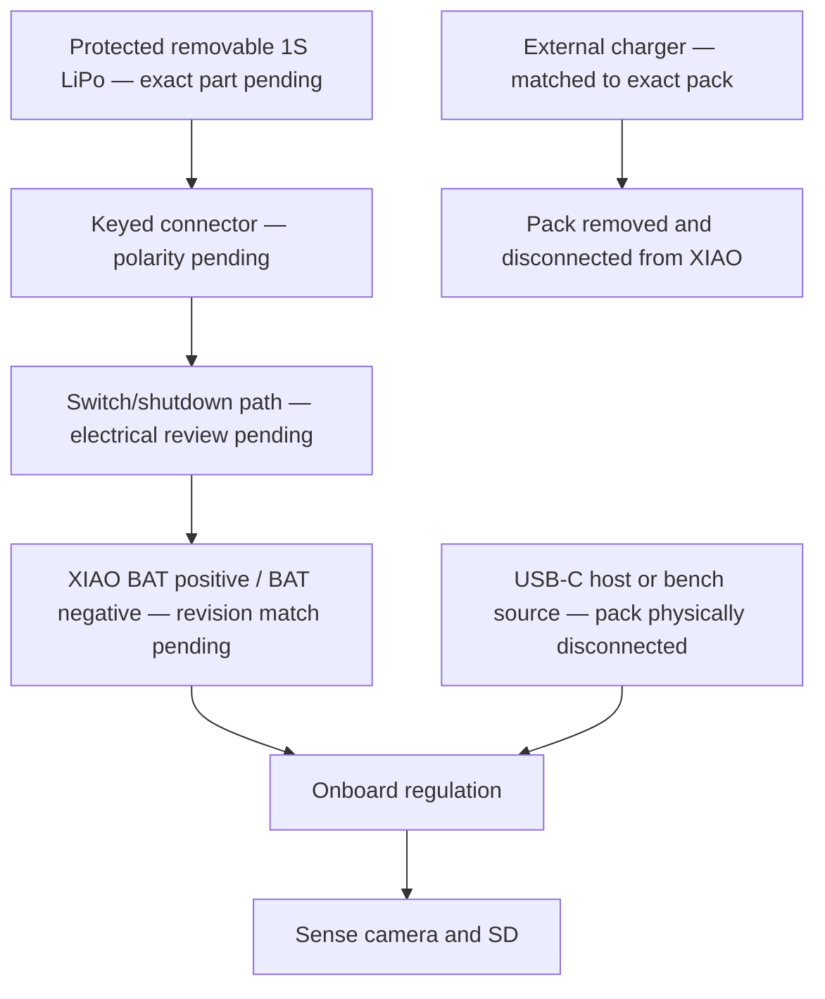

# Prototype A: hardware identity and electrical preparation (0.3)

Status: **PREPARED FOR REVIEW; electrical approval UNVERIFIED**, 2026-11-23.
Prototype A is a project label, not an assertion of Seeed's PCB revision.

Start with this record, the [candidate pin map](pin-map.csv),
[recording rubric](../../docs/specs/recording-acceptance.md), and
[card/bench assignment](bench-plan.md). Requirements remain in the
[hardware specification](../../docs/specs/hardware.md).

## Selected configuration and missing identities

| Item | Current record | Evidence needed before signoff |
| --- | --- | --- |
| Board | Owner selected Seeed Studio XIAO ESP32-S3 Sense, not Plus | Actual base PCB revision, module marking, seller/SKU and matching schematic |
| Expansion | Matching Sense camera/microSD assembly intended | Actual expansion PCB revision, connector orientation/retention and matching schematic |
| Camera | Owner selected OV5640; reference design uses the Sense fixed-focus module | Module/flex marking, lens and orientation; later driver-detected sensor ID; no autofocus assumption |
| Memory | Vendor baseline 8MB flash / 8MB octal PSRAM | Actual flash/PSRAM detection during 1.2, separate from a successful build |
| Storage | Genuine 32GB SDHC / FAT32 baseline; owner allows any brand | Exact model/source, usable capacity, filesystem/allocation and later SDSPI measurements |
| Battery | Owner selected lithium-polymer; exact part not purchased/selected | Supplier datasheet, protection, charge/discharge limits, polarity, connector, mass/dimensions |
| Battery baseline | Retain proposed protected 1S nominal 3.7V 1000mAh removable pack | Confirm exact selected part meets the baseline; no claim of measured runtime |
| External charger | No model selected | Explicit compatibility with the selected pack; connector/polarity, voltage/current/termination review |
| Host | macOS, Windows or Linux acceptable to owner | One actual host/architecture/version/tool record for each executed qualification |
| Tools | Owner reports card reader, USB-C data cable and soldering tools | Multimeter/current-limited supply/temperature measurement availability not established |

The owner's daytime ground-object goal is **0.5–1 m from the camera**. Exact
dog/harness geometry and assembly mass remain needed before final fit. Product
cost, battery runtime, storage retention and all electrical measurements remain
UNVERIFIED. LiPo chemistry alone does not establish protection, charger
compatibility or permission to use an arbitrary charger.

## Source register (checked 2026-11-23)

- **S1:** [Seeed getting started](https://wiki.seeedstudio.com/xiao_esp32s3_getting_started/):
  board variants, stock fixed-focus OV5640, memory and battery documentation.
- **S2:** [Seeed pin multiplexing](https://wiki.seeedstudio.com/xiao_esp32s3_pin_multiplexing/):
  Sense peripheral GPIO reference, USB/controls/header functions and CS/LED sharing.
- **S3:** [Seeed microSD guide](https://wiki.seeedstudio.com/xiao_esp32s3_sense_filesystem/):
  32GB/FAT32 reference and expansion/card installation.
- **S4:** [Espressif camera reference](https://github.com/espressif/arduino-esp32/blob/master/libraries/ESP32/examples/Camera/CameraWebServer/camera_pins.h),
  `CAMERA_MODEL_XIAO_ESP32S3`: camera pin order and absent PWDN/RESET GPIOs.
  This cross-check does not change the project's ESP-IDF framework.
- Revision-specific schematics are linked under S1's Sense resources. Download,
  record their exact filenames/revisions/hashes and reconcile them against the
  actual boards before approval. This preparation has not reviewed those PDFs
  or established which revision the owner holds. Web pages/`master` can change;
  archive the applicable revision references with the actual-unit record.

The pin CSV records **SoC GPIO numbers**, not physical connector contact
numbers. Internal net names are functional labels. A `PENDING_REVISION_MATCH`
location must be resolved to actual pad/contact/net references by the reviewer.
All voltage domains, pulls and reset behavior need revision-matched review;
no external wiring is authorized by these candidate rows.

## Ownership decisions for review

1. Camera owns DVP, SCCB and XCLK; preserve its data-bit ordering. No microphone
   initialization, clock or recording is allowed by the product baseline.
2. SD owns SPI SCK/MISO/MOSI/CS. GPIO21 is also documented as the user LED:
   the CSV's two GPIO21 rows are intentional. Never drive a heartbeat, blink or
   PWM task independently while the card is mounted. Resolve actual CS/LED
   circuitry and reset state; reject any pin conflict instead of guessing CS3.
3. Keep native USB GPIO19/20 and BOOT/reset recovery available. Do not adopt
   a Plus battery-ADC map: GPIO10 is the Sense camera clock. Battery telemetry
   remains unknown without a separately reviewed circuit.
4. BOOT is a strap, reset restarts the firmware, and a button gesture has not
   been qualified. Local-access/reset gestures and an independent non-color-only
   recording/error/radio indicator remain open design items. The charge LED
   does not demonstrate recording. No extra GPIO, resistor or switch is assigned.

## Power and service modes — block diagram, not build-ready wiring

The diagram shows **alternative operating modes**, not simultaneous source
connections. Onboard charging hardware exists, so an off switch is not proof
of isolation from USB. The pack service connector must physically disconnect
the cell from BAT before USB-C power/programming/logging. Remove the whole
camera from the harness, power down, unplug/remove the pack, and charge it
externally using its approved charger. Disconnect the charger before pack
reinstallation. No added 5V boost, battery ADC or dual-source circuit is assumed.

Do not solder or connect an unselected pack using this block diagram. Before
assembly, the reviewed diagram must specify actual connector contacts,
polarity, switch topology, wire/component ratings, mechanical strain relief,
protection and test points. Do not solder directly to a pouch cell. A qualified
reviewer must select permitted measurements and limits from the exact parts;
do not inject battery voltage into GPIO/3V3 or infer polarity from wire color.

## Electrical closure record

| Check | Required evidence / owner | Current status |
| --- | --- | --- |
| E01 Actual identities | Board/expansion/camera photos and exact revision-matched sources | UNVERIFIED |
| E02 Pin/net audit | Complete location, voltage, pulls/reset and internal memory/strap audit; CS/LED ownership resolved | UNVERIFIED |
| E03 Service circuit | Selected protected pack, connector and switch diagram; USB isolation and compatible external charger | UNVERIFIED |
| E04 Controls/status | Reviewed local-access gesture and truthful independent indication; recovery preserved | UNVERIFIED |
| E05 Assembly inspection | Power disconnected; qualified solder/joint/short/polarity/continuity inspection | UNVERIFIED |
| E06 Controlled power checks | Approved source/current limit, measured rails/peaks/droop, cutoff and recovery results | UNVERIFIED |
| E07 Review | Named qualified electrical reviewer, date, revision/commit and verdict with resolved findings | UNVERIFIED |

Record the exact unit ID, document/firmware commit, equipment/limits, expected
and measured values, evidence references and reviewer verdict for each row.
An AI document consistency check is not E07. Full peripheral/runtime tests
belong to Stage 1; this record must not mark them passed before they execute.
No device, port or physical operation has been authorized or exercised here.
